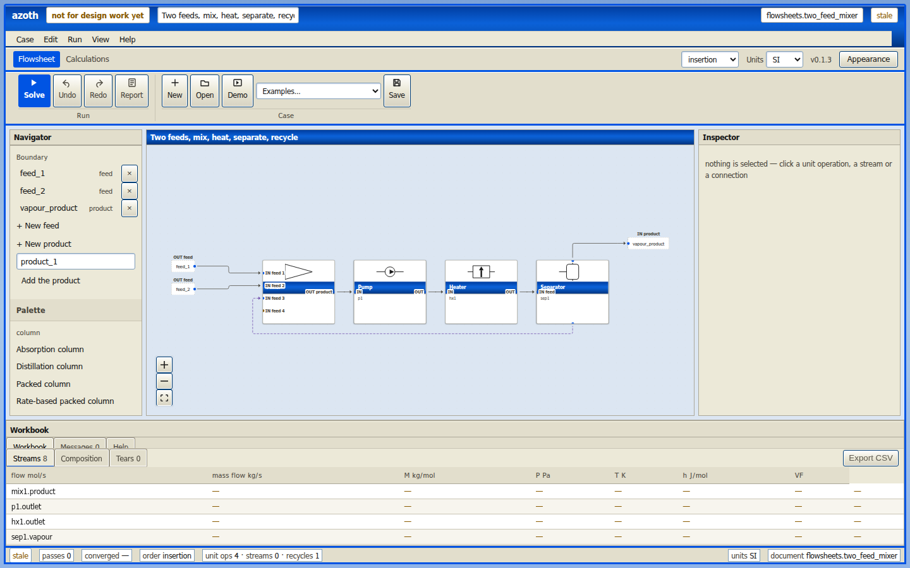
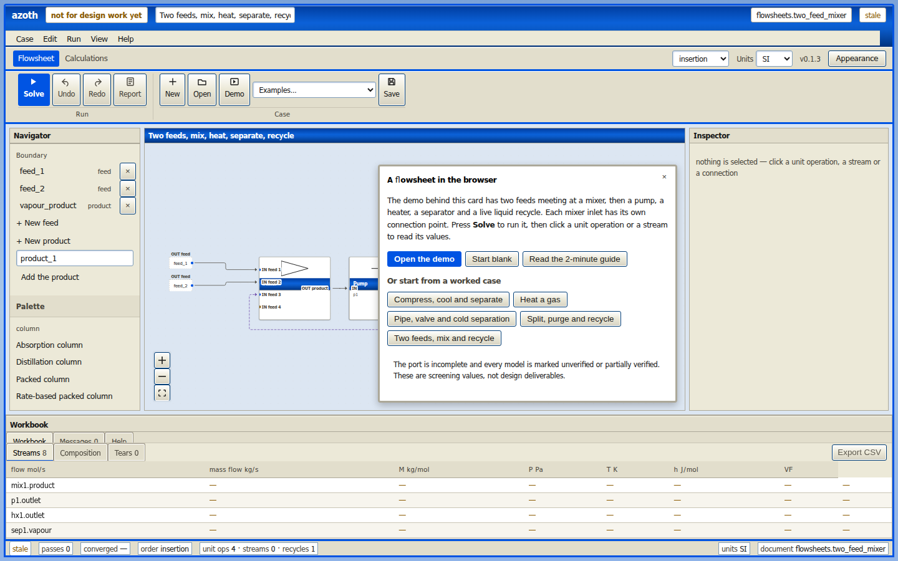

# The editor

The flowsheet editor is a process flowsheet in a browser: a palette of unit operations, a
drawing, a window for the selected object, and a workbook of every stream. The calculations run
in the page — the engine is compiled to WebAssembly — so nothing is installed and no case is
uploaded.

**[Open the editor →](https://patrickmockridge.github.io/azoth/)**

## First five minutes

1. The demo opens on its own: a feed, a pump, a heater, a separator and a liquid recycle.
2. Press **Solve**. The status changes from `stale` to `solved`, and each connection shows the
   temperature and pressure the run reached.
3. Click a unit operation to open its window. **Design** holds the parameters, **Conditions** the
   feed or product stream, **Worksheet** the streams on its ports, and **Results** whatever the
   model reached besides its streams.
4. Open **Workbook** at the bottom for every stream in one table. **Messages** holds the model
   check's findings and any run error; clicking an entry selects the object it is about.
5. **Case → Examples** opens other worked cases.

## The drawing

- Drag from an outlet handle to an inlet handle to connect two objects. Every connection point
  says `IN` or `OUT`; a two-stream exchanger labels `hot` and `cold` on each side.
- Click an object to select it; drag a unit operation to move it.
- Delete or Backspace, or **Remove** in the object's window, removes the selected object. A removed
  feed takes its connections with it; **Undo** restores it.
- A connection can be turned into a **tear** — a recycle — from its Connections sheet. A tear is
  drawn as a moving line and is iterated until its residual is small.

## Feeds, products and units

A **feed** is four numbers and a fluid: molar flow, pressure, temperature and composition. Use
the component picker rather than spelling substance names; the databank is what decides whether a
name exists.

A **product** is a name only: its stream is calculated.

The unit set at the top right changes what is *shown* — SI or field units, including °C and °F.
It never changes the document, and solving has no opinion about it.

## What the numbers mean

**Checks** on a unit operation names the model, how far it is verified, and the hashes of the
declaration and the kernel that produced the number. **Caveats** on a result sheet are the calculation's own warnings — a bound that could not
be checked, a correlation at the edge of its range.

The port is incomplete. Every shipped model is marked `unverified` or `partially_verified`, and
what is missing is recorded in the [road map](../agentic/roadmap.md) and at the front of this
book. **These are screening values, not design deliverables.**

## Saving and printing

**Save** writes the case under its name as a TOML document; **Open** reads one back. The header's
case-name field sets that name. The workbook exports to CSV,
and **Report** prints or saves a case file with the drawing, the streams, the results, the
caveats and the source record.

The **Calculations** switch opens a separate workspace for the library's standalone calculations.
See [calculation sheets](./calculations.md).
